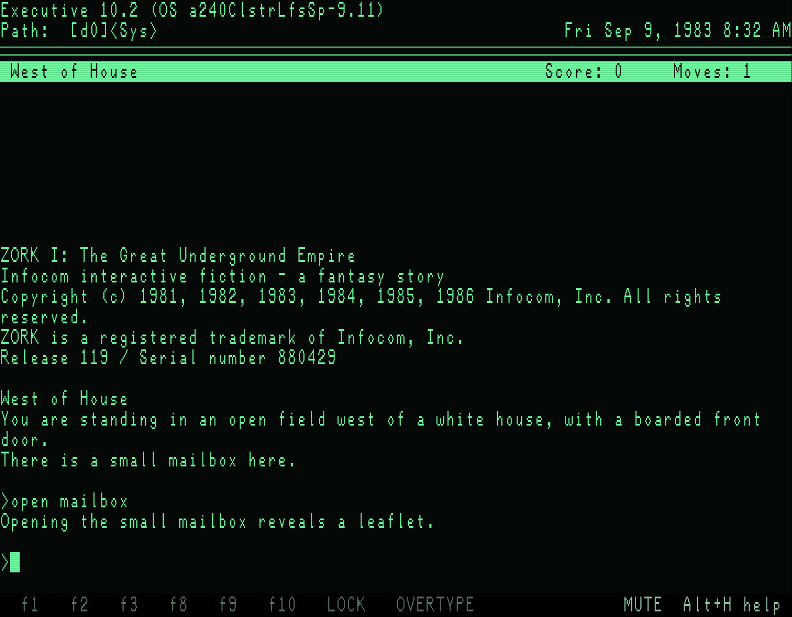

# Zork I for the Convergent AWS and NGEN
## (c) Scott Baker, https://www.smbaker.com/

This is a Z-machine interpreter for Convergent CTOS, written in 8086 assembly. It plays
Infocom's original Zork I story file (release 119, serial 880429) on the AWS-2x0 and the
NGEN (B26). The same `Zork.run` runs on both.



## Playing

`dist/Zork.img` is a floppy image in the format the AWS and the NGEN both use: 77
cylinders, 2 sides, 16 sectors of 256 bytes. It holds `<Zork>Zork.run` and
`<Zork>Zork1.dat`. It works the same in the
[AWS and NGEN simulator](https://github.com/sbelectronics/aws-simulator), where you insert it
from the Drives menu or with `-floppy`.

- **To play from the floppy:** at the Executive, use `Path` to set `Volume` to `f0` and
  `Directory` to `Zork`. Then run `Run`, set `Run file` to `[f0]<Zork>Zork.run`, and press
  GO.
- **To install on the hard disk** (the better way on a hard disk system):
  1. `Copy` `[f0]<Zork>Zork.run` to `[Sys]<Sys>Zork.run`.
  2. `Copy` `[f0]<Zork>Zork1.dat` to `[Sys]<Sys>Zork1.dat`.
  3. `New Command`, with `Command name` set to `Zork`, `Run file` set to
     `[Sys]<Sys>Zork.run`, and `[Field names]` set to `'[Story file]'` (with the quotes).
     Then type `zork` and press GO.

### The story file

The first field of the command form names the story file: `[Story file]` in a command made
as above, or `[Param 1]` in `Run`'s form.
- **If it's given,** `Zork.run` opens that file and nothing else.
- **If it's empty,** `Zork.run` opens `Zork1.dat` in the current path, then
  `[Sys]<Sys>Zork1.dat`.

If it can't open the story, it says which file or places it tried, and returns to the
Executive.

Any version 3 story file works this way, such as Zork II and Zork III. Later versions are
refused.

It needs about 115 KB of free memory: 100 KB for the story and 13 KB for itself.

### In the game

- **Status line:** the top line of the screen, in reverse video, shows the room, the score
  and the number of moves. Text scrolls below it.
- **Typing:** RETURN or GO ends a command, and BACKSPACE deletes. Output pauses with
  `[MORE]` when a screenful has gone by.
- **Saving:** `save` and `restore` ask for a file name. RETURN uses the story's file name
  with `.sav` in place of its extension (`Zork1.sav` for `Zork1.dat`), in the current path.
  A save file is about 16 KB.
- **Leaving:** `quit` asks whether you're sure, then returns to the Executive.
- **Not supported:** `script` prints the game's own transcript message, but nothing goes to
  a printer.

## How it works

- **The interpreter:** `src/zork.asm` (about 2,800 lines) implements Z-machine version 3:
  - every version 3 opcode, though `split_window`, `set_window`, the output and input
    streams and `sound_effect` do nothing, and `verify` always succeeds;
  - text decoding with abbreviations;
  - the object tree and properties;
  - the dictionary and tokeniser;
  - the status line;
  - save, restore and restart.
- **One segment:** the program is a single segment (CS = DS = SS) entered at offset 0.
- **CTOS calls:** it calls CTOS through the fixed far addresses of the requests and OS
  subroutines, so it needs no CTOS library and no relocations. `NOTES.md` lists them.
- **Story memory:** the story is read whole, into 32 KB chunks from `AllocMemorySL`. Each
  chunk is 512 bytes longer than 32 KB, so a word that straddles two chunks still reads
  correctly. Dynamic memory, the only part the game writes, is all in chunk 0. No paging is
  needed.
- **Screen:** Zork uses frame 0 as the Executive leaves it, through `PutFrameChars`,
  `PutFrameAttrs`, `ScrollFrame` and `PosFrameCursor`. Line 0 of the frame is the status
  line. It finds the frame's height by asking `PosFrameCursor` for lines until one is
  refused.
- **Keyboard:** `ReadKbd`.
- **Random numbers:** a 32-bit linear congruential generator, seeded from `GetDateTime`. It
  is the same generator Frotz uses, which makes the comparison with Frotz possible.

## Building

The build needs:
- **Python 3 with unicorn.** The scripts use `PY` if it's set, then `.venv` in this
  directory, then `python3`:
  ```sh
  python3 -m venv .venv && .venv/bin/pip install unicorn     # Windows: .venv/Scripts/pip
  ```
- **The Intel ASM86 assembler, `asm86.86`.** It is Intel's software, so it isn't included.
  It ships on CTOS system and development disks. `tools/getorig.sh` finds it in a copy of
  such disks, checks its SHA-256 against the version used here, and copies it to `orig/`:
  ```sh
  sh tools/getorig.sh /path/to/ctos/disks
  ```

Then:

```sh
sh tools/build.sh          # work/Zork.run
```

The assembler runs under `udi/udi86.py`, an emulator for Intel's UDI programs. It and
`udi/omf86.py` are copies of the ones in [Rats](https://github.com/sbelectronics/rats), and so is
`tools/omf2.py`, which reads the object file. `tools/mkrun.py` turns the one-segment object file into a
CTOS V4 run file.

### The floppy

`tools/mkfloppy.py` makes the floppy image. It uses
[ctostool](https://github.com/sbelectronics/ctostool), which needs Python 2, and starts from any
CTOS floppy image with one directory besides `<Sys>`:

```sh
python2 tools/mkfloppy.py --ctostool /path/to/ctostool template.img work/Zork.img \
    work/Zork.run story/Zork1.dat
```

It deletes the files in the template's directory (`--dir` picks one if there are several),
renames it `<Zork>`, adds the two files, and zeroes the pages the deleted files used. It
also zeroes the template's OS image, `<Sys>sysImage.sys`, since the floppy is never booted,
and names the volume `Zork`.
`CTOSTOOL` can name the ctostool directory instead of `--ctostool`.

`dist/` holds the current `Zork.run` and `Zork.img`, since `work/` isn't kept in git.

## Testing

`tools/zharness.py` runs `Zork.run` on the PC, in a unicorn 8086 with the CTOS calls it uses
emulated. It types each line of an input file and prints the transcript. The harness's clock
always gives the same time, so the game's random numbers are the same every run.

```sh
sh tools/runtests.sh
```

plays each `test/*.txt` and compares the transcript with `test/*.expected`:
- `walk1`, `walk2`, `restart` and `t1`: the house, the troll fight, save and restore, restart,
  and odd commands;
- `full`: the dam and the exorcism in Hades;
- `rwalk`, `rwalk11` and `rwalk23`: that route, followed by 600 to 1,000 random commands,
  including a death and resurrection;
- `param`, `nofile` and `nostory`: a story named on the command form, which saves to
  `Zork2.sav`; a named story that's missing; and no `Zork1.dat` anywhere.

A test with a `test/X.param` file is run with its first line as the story file field. The
story file is copied into the test's directory under the name on its second line, or not at
all if that line is blank.

`tools/compare.sh test/X.txt` plays an input through `dfrotz`, the dumb-terminal
[Frotz](https://gitlab.com/DavidGriffith/frotz), with the same random seed, and compares the
two transcripts word by word. `DFROTZ` names dfrotz if it isn't on the path, and `ZHOST=user@host`
runs it on another machine over ssh. Every test without a `.param` file matches Frotz. The only differences come from
the interpreters themselves: the file-name prompts for save, restore and transcripts, the end
of the input, the screen Frotz clears when the game restarts, and Zork.run's prompt to press
a key after `quit`.

## Licenses

- **The story file:** `story/Zork1.dat` is `COMPILED/zork1.z3` from
  [historicalsource/zork1](https://github.com/historicalsource/zork1), which Microsoft
  released under the MIT license in November 2025 (`story/LICENSE-zork1`).
- **The interpreter:** written from the Z-Machine Standard 1.1, with no code from other
  interpreters.
